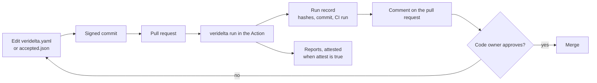

# Tracing a verdict

A verdict is traceable when a reviewer can tell which rules produced it, who declared them, and who approved the change. Veridelta keeps no ledger of its own for this. Git records who changed the configuration and the baseline, GitHub records who approved each pull request, and each run's [run record](results.md#run-record) ties the verdict to both by hash and commit.

## What records what

| Question | Where the answer lives | How to make it trustworthy |
| :--- | :--- | :--- |
| Who declared a rule or accepted drift? | The commits that changed the configuration file and the baseline file. | Require signed commits, so an author cannot be forged. |
| Who approved the change? | The pull request's reviews. | Require a review from the file's code owners. |
| Did the report judge those exact files? | The run record: each file's SHA-256, the commit, and the CI run. | Recompute a hash at the recorded commit. |
| Did this workflow write the report? | An artifact attestation of the reports. | Set the Action's `attest` input, and verify with `gh attestation verify`. |



## Signing commits

A signed commit carries a signature that GitHub checks against a key on the author's account, so `git log` shows who declared a rule. Git signs with an SSH key you already use:

```bash
git config --global gpg.format ssh
git config --global user.signingkey ~/.ssh/id_ed25519.pub
git config --global commit.gpgsign true
```

Add the same public key to your GitHub account as a signing key. GitHub then marks each commit as verified. A ruleset that requires signed commits on the default branch refuses any commit that is not.

## Requiring a code owner's review

A `CODEOWNERS` file names who must approve a change to the files that decide a verdict:

```text
# .github/CODEOWNERS
veridelta.yaml   @acme/data-owners
accepted.json    @acme/data-owners
```

A ruleset, or branch protection, that requires a review from code owners then holds every change to a rule or to accepted drift until one of them approves it. This repository, which is public, enforces its rules with a ruleset. For a private repository, GitHub offers rulesets on its Team and Enterprise plans; see [About rulesets](https://docs.github.com/en/repositories/configuring-branches-and-merges-in-your-repository/managing-rulesets/about-rulesets).

## Checking a report against its commit

The pull request comment and the HTML report name the run record. To check that a report judged the configuration at its commit, hash the file as that commit holds it, and compare the result with `config_file.sha256`:

```bash
git show abc1234:veridelta.yaml | sha256sum
```

A different hash means the run read a file the commit does not hold, such as one edited in the workspace. `working_tree_clean: false` says the same of any tracked file.

## Attesting the reports

With `attest: true`, the Action attests the JSON summary, the Markdown summary, and the HTML report through [GitHub artifact attestations](https://docs.github.com/en/actions/concepts/security/artifact-attestations). An attestation is a signed statement that this workflow, at this commit, wrote those exact files. The workflow needs three permissions:

```yaml
permissions:
  contents: read
  id-token: write
  attestations: write
  artifact-metadata: write
```

Anyone with the report and access to the repository can then check where it came from:

```bash
gh attestation verify report.html --repo acme/orders
```

On a public repository, the attestation is also written to Sigstore's public transparency log, which anyone can read. GitHub's [attest action](https://github.com/actions/attest) supports attestations on public repositories on every current plan, and on private or internal repositories only on GitHub Enterprise Cloud. GitHub Enterprise Server does not support them.
